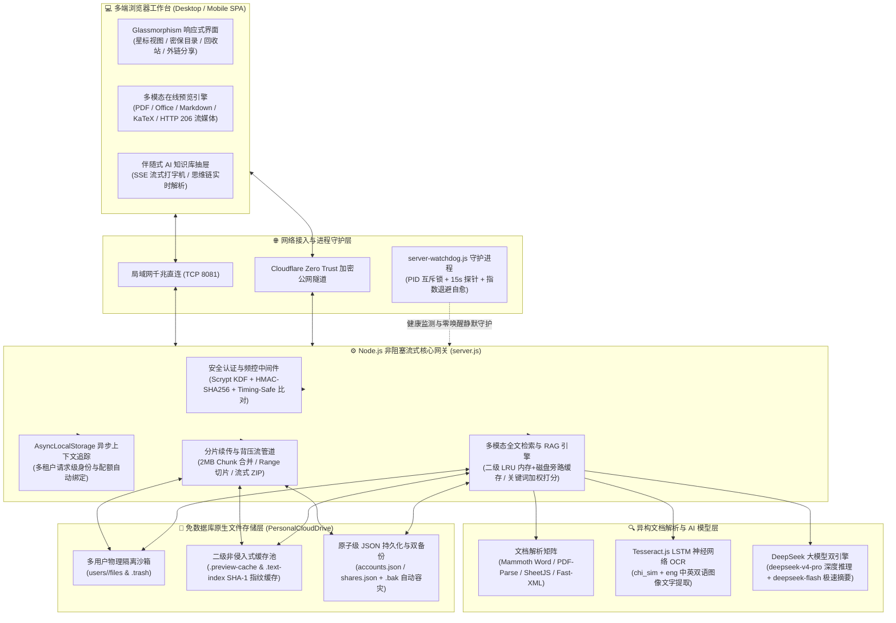

# DPSir 个人私有智云盘 (Personal Cloud Drive)

<p align="left">
  
  
  
  
  
  
  
</p>

> 🚀 **简洁、轻量、高性能的 AI 赋能私有化个人云盘系统**。集成了局域网千兆流式传输、Cloudflare 零信任公网穿透、大文件分片断点续传、多租户物理沙箱隔离、Office/PDF/LaTeX 原生高清预览、Tesseract 神经网络 OCR 以及 DeepSeek RAG 全库智能问答，支持 Windows / macOS 一键静默部署与换机无损迁移。

---

## 📸 界面预览 (UI Screenshots)

| 🎨 专属视觉登录界面 | 🖥️ 现代化网盘管理主界面（全新底部用户中心与存储看板） |
| :---: | :---: |
|  |  |

| 👥 用户账号管理与配额安全调控（全新单方案重置密码） | 🛡️ 个人密码与安全中心（3-Tab 管理与安全应急凭据卡） |
| :---: | :---: |
|  |  |

### 🤖 智能 AI 全库问答与深度检索 (DeepSeek 驱动 · 300ms 纯 GPU 伴随式丝滑吸附抽屉)
<p align="center">
  
</p>

### 📑 文档在线高清原生预览与 AI 一键智能提炼总结
<p align="center">
  
</p>

---

## 🏛️ 系统架构与核心算法框架 (Architecture & Core Algorithms)

### 1. 全栈拓扑架构图



### 2. 核心算法与工程技术矩阵

| 技术维度 | 核心算法 / 框架机制 | 工程实现与独特价值 |
| :--- | :--- | :--- |
| **密码学与安全隔离** | **Scrypt 内存硬哈希 + HMAC-SHA256 + `timingSafeEqual`** | 登录密码、私密文件夹挂锁及恢复密钥均采用随机盐值 `scryptSync` 派生，结合恒定时间字节比对算法防御时序侧信道攻击（Timing Attack）与暴力穷举。 |
| **多租户并发上下文** | **`AsyncLocalStorage` (`node:async_hooks`) + 路径沙箱算法** | 在异步 I/O 调用链中无感追踪当前租户身份，配合 `path.resolve` 前缀锁定算法，实现用户间物理文件、回收站、配额的 100% 严密隔离。 |
| **大文件传输与流媒体** | **2MB 分片流式管道 + HTTP 206 Range 切片 + 流式 DEFLATE** | 超大文件分片并发上传与背压控制合并（零内存溢出）；音视频支持 RFC 7233 字节范围请求任意拖拽点播；多文件批量下载边读边压直推浏览器。 |
| **全文检索与二级缓存** | **SHA-1 文件指纹 (`path+size+mtime`) + 内存/磁盘二级 LRU 缓存** | 首次提取 PDF/Word/PPT/Excel/OCR 文本后自动写入内存 LRU 与 `.preview-cache/.text-index` 旁路磁盘缓存；文件未改动时二次检索与 AI 读取耗时 **< 1ms**，修改后毫秒级自动失效更新。 |
| **多模态 AI 知识库** | **本地 RAG 检索增强 + Tesseract LSTM OCR + SSE 流式推送** | 结合深度优先遍历（DFS）、词频相关性加权打分与双语神经网络图像文字识别，将本地异构文档转化为 DeepSeek 模型的精准上下文。 |
| **高可用与跨平台运维** | **指数退避自愈算法 (Exponential Backoff) + 100% 纯 ASCII 脚本内核** | 守护进程异常崩溃后按 $3\text{s} \to 6\text{s} \to 12\text{s} \dots \le 60\text{s}$ 退避拉起，日常待机 0% CPU 静默运行；全套 Windows/macOS 运维脚本采用纯 7-bit ASCII 编码，彻底免疫跨系统代码页乱码。 |

---

## ✨ 核心特性

- **⚡ 高速传输与断点续传**
  - 支持大文件自动分片（1MB/2MB）、双通道并发上传与失败指数退避重试；
  - 云端哈希快速秒传，避免重复上传相同文件；
  - 下载支持 HTTP 206 Range 断点续传与流式直推，局域网千兆直连可达 100+ MB/s。

- **📊 精细化存储配额与隐私安全隔离**
  - **全新流线型存储看板**：侧边栏实时呈现容量状态（充裕/预警/告急三档阶梯）、平滑动效进度条、余量胶囊及当前目录文件夹/文件即时计数；
  - **角色级数据隔离**：普通用户严格按个人配额（如 20.0 GB）计算余量与百分比，后端自动脱敏宿主机硬件参数，100% 杜绝服务器物理磁盘泄露；
  - **动态可视化调控**：管理员后台一键调整任意账号配额（10GB、20GB、50GB、100GB、不限或自定义），超额上传毫秒级安全拦截阻断。

- **⭐ 文件与文件夹星标收藏 & 侧边栏极简收纳**
  - 支持对高频、重要文件及文件夹一键标星（⭐），快速置顶；
  - 侧边栏专属「我的星标」视图，毫秒级快速筛选聚合所有星标资产，支持多选批量加星与取消；
  - **访问与存储原生收纳折叠**：一体化整合「存储位置」与「网络访问」，支持原生平滑手风琴收纳；收起时仅占 36px 极简单行，动态呈现呼吸状态微胶囊（本机科技蓝、局域网翡翠绿、公网暖金橙三色精准映射），大幅释放侧边栏垂直视野，展开/收起偏好本地持久记忆。

- **📑 强大的文档与多媒体原生预览 & 极简纯图标设计**
  - **Office 系列**：支持 Word (`.docx`)、PowerPoint (`.pptx`)、Excel (`.xlsx`/`.csv`) 原生表格与高保真排版预览；
  - **PDF 与科研文本**：支持 PDF 在线分页阅读、Markdown、代码语法高亮及 **KaTeX ($\LaTeX$) 数学公式** 原生排版；
  - **多媒体与图片**：图片高清灯箱浏览、音视频在线流畅播放与流式拖拽；
  - **纯图标全局统一操作栏**：预览弹窗与压缩包弹窗统一无文字纯图标设计，AI 一键总结采用 DeepSeek 专属水青色微光质感，尺寸与下载、关闭按钮完美统一 38px 规格对齐。

- **🔍 AI 智能辅助与全文搜索 (DeepSeek 驱动 + 二级旁路缓存加速)**
  - 支持毫秒级文件名检索与 PDF / Office / 代码 / 图片 OCR 全文关键词搜索；
  - 内置非侵入式二级文本索引缓存（Memory LRU + Disk Sidecar），已解析文档二次检索与 AI 问答秒级响应；
  - 侧边 AI 智能抽屉面板，支持与个人知识库全库深度问答、单文档一键极速提炼总结。

- **🔒 安全权限、外链分享与回收站机制**
  - 单用户/多用户安全鉴权，防爆破滑动窗口安全频控；
  - **多状态加密文件夹挂锁**：直观区分普通目录与已加锁机密目录，支持独立安全密码与子目录权限继承；
  - **安全外链分享与回收站防误删**：支持生成带有效期与提取码的分享链接；删除文件自动进入个人 `.trash` 回收站，支持随时一键还原或彻底粉碎。

- **🛠️ 专为家庭服务器 / Windows 小主机 / Mac 电脑优化**
  - **程序与数据完全解耦**：代码与数据盘（`PersonalCloudDrive`）物理隔离，真正的原生目录结构，随时随地任意换机或扩展硬盘；
  - **一键部署**：自带环境自检、防火墙全网络放行、开机静默守护任务安装；
  - **云端热更新**：双击一键从 GitHub 拉取代码并平滑重启。

---

## 🚀 快速上手

直接双击运行根目录下的：
```text
start-lan-drive.bat
```
或通过命令行：
```bash
npm install
npm start
```
启动后在任意浏览器中打开：
- **本机极速访问**：`http://127.0.0.1:8081`
- **局域网其他设备（手机/平板）**：`http://你的电脑IP:8081`（如 `http://192.168.1.xxx:8081`）

---

## 🖥️ 新主机 / 新用户 极速部署指南 (Quick Deployment)

无论是在全新的 Windows 小主机、家庭服务器、闲置电脑还是 Mac 上部署，每台新电脑默认都是一套**100% 独立、纯净的局域网私有云盘**（自带全部核心网盘功能、独立账号库、独立数据盘及独立随机生成的 32 字节安全会话密钥，支持 30 天滑动免登录自动续期），与开发机或其他电脑完全解耦、互不干扰。

### 1. 获取代码（内置国内 4 节点免外网极速通道）
```bash
# 国内网络免外网极速克隆（推荐，全程无需开启 VPN/梯子）：
git clone https://gh-proxy.com/https://github.com/6DPS/personal-cloud-drive.git
cd personal-cloud-drive

# 备用国内加速源（任选其一）：
# git clone https://ghfast.top/https://github.com/6DPS/personal-cloud-drive.git
# git clone https://ghproxy.net/https://github.com/6DPS/personal-cloud-drive.git

# 或使用 GitHub 官方源克隆：
git clone https://github.com/6DPS/personal-cloud-drive.git
```
*(💡 若新电脑未安装 Git，也可直接在浏览器打开国内加速直链下载 ZIP 压缩包解压即用：`https://gh-proxy.com/https://github.com/6DPS/personal-cloud-drive/archive/refs/heads/main.zip`)*

---

### 2. 一键全自动初始化与启动（国内源零外网依赖）

* **🪟 Windows 电脑 / 小主机**：直接双击运行根目录下的 👉 **`一键部署新电脑(Windows).bat`**（或 `setup-new-host.bat`）
* **🍎 苹果 Mac 电脑 (Apple Silicon M系列 / Intel)**：直接双击运行根目录下的 👉 **`一键部署新电脑(Mac).command`**

向导会在后台全自动完成以下全部工作（全程走国内镜像源，无需翻墙）：
* ✓ **Node.js 环境自动就绪**：若电脑未安装 Node.js，自动从华为云 / 阿里云国内高速镜像下载并静默安装 LTS 版本；
* ✓ **依赖包国内极速装载**：自动使用国内 NPM 镜像（`registry.npmmirror.com`）完成 `npm install`；
* ✓ **智能绑定大容量数据盘**：自动探测大容量硬盘（如 `D:\PersonalCloudDrive`，仅单 C 盘电脑自动适配 `C:\PersonalCloudDrive`）并自动生成专属 `.env` 配置文件；
* ✓ **全网络防火墙自动放行（公用+专用+域）**：自动唤起管理员提权放行 8081 端口，彻底解决插网线与连 Wi-Fi 切换时的防火墙拦截；
* ✓ **开机后台静默自启守护**：自动注册 Windows 任务计划（或 macOS `launchd` 守护进程），并自动记忆国内最快 GitHub 更新通道。

部署完成后，网盘即刻以**纯净局域网模式**启动，在浏览器中打开：
* **本机极速访问**：`http://127.0.0.1:8081`
* **局域网设备（手机/平板/电脑）**：`http://你的电脑IP:8081`（如 `http://192.168.1.xxx:8081`，**手机端请务必完整输入开头的 `http://`**）
* **初始超级管理员账号**：账号 `admin` / 初始密码 `admin123456`（登录后可在安全中心随时修改）

---

### 3. 按需接入「大模型 AI」与「公网远程访问」（可选进阶）

新部署的电脑默认无需任何外部密钥即可完整使用全部网盘存储、预览与加密分享功能。若新电脑使用者希望开启 **AI 知识库问答/总结** 或 **出门在外公网访问**，可按以下极简方式随时接入：

#### 🤖 (A) 接入大模型 AI（DeepSeek API —— 二选一，网盘自动读取）
先在 [DeepSeek 开放平台](https://platform.deepseek.com/) 申请属于自己的 API Key（`sk-...`），随后**任选以下一种方式**配置即可（无需改代码，前端零配置）：
1. **方式一：在 `.env` 文件中配置（最直观）**  
   用记事本打开项目根目录下的 `.env` 文件，填入：
   ```env
   DEEPSEEK_API_KEY=sk-你的DeepSeek密钥
   ```
2. **方式二：在电脑系统环境变量中添加（免改 `.env`，更安全隐蔽）**  
   不用修改 `.env` 文件，直接在 Windows「系统属性 ➔ 环境变量」中添加用户变量或系统变量：
   * 变量名：**`YUNPAN_DEEPSEEK_KEY`**（或 `DEEPSEEK_API_KEY`）
   * 变量值：**`sk-你的DeepSeek密钥`**

> 配置完成后，双击根目录下的 👉 **`一键重启与自动修复.bat`**，网盘会自动读取密钥并激活 AI 全库对话与单文档极速总结！

#### 🌐 (B) 接入公网远程访问（一步直达，无需手动在 `.env` 填域名）
> ⚠️ **注意**：单纯在 `.env` 里手写一个域名并不能让外网连进你的电脑（必须建立公网穿透隧道）。本项目已将隧道创建、DNS 绑定与 `.env` 写入全流程封装为一键脚本：

* **方案 1：已有个人域名 —— 长期固定公网域名（推荐）**
  1. 将你的域名托管在 Cloudflare（免费），然后直接双击根目录下的 👉 **`setup-cloudflare-domain.bat`**；
  2. 在黑框提示中输入你想绑定的完整域名（例如 `pan.yourdomain.com`）；
  3. 脚本会自动下载穿透组件并**自动弹出浏览器登录页**，你在网页上点击一次 **【Authorize（授权）】**；
  4. **全自动收尾**：脚本会自动创建专属加密隧道、自动在 Cloudflare 添加 DNS 解析记录、**自动把 `PUBLIC_ACCESS_URL=https://你的域名` 写入 `.env` 文件**（无需你手动编辑 `.env`！），并自动配置开机后台静默自启与重启网盘。完成后全球任意手机/电脑输入该域名即可秒开！
* **方案 2：没有个人域名 —— 免注册临时公网地址（即开即用）**
  * 直接双击根目录下的 👉 **`start-public-drive.bat`**，无需购买域名、无需登录账号，脚本会在几秒内自动生成一个免费的 `https://xxxx.trycloudflare.com` 临时公网加密网址，复制发给手机或朋友即可直接外网访问。

详细两台电脑无缝换机、数据迁移与协同开发教程请参阅：
* 👉 **[Windows小主机部署与迁移指南.md](./Windows小主机部署与迁移指南.md)**
* 👉 **[苹果Mac电脑部署与开发指南.md](./苹果Mac电脑部署与开发指南.md)**
* 👉 **[个人网盘后续开发与版本迭代指南.md](./个人网盘后续开发与版本迭代指南.md)**

---

## 🔑 账号权限与新用户注册体系

* **超级管理员身份识别**：
  * 使用上面设定的管理员账号（默认 `admin` / `admin123456`）登录；
  * 登录成功后，左侧导航栏会**独占显示【🔑 注册密钥管理】按钮**，代表最高管理权限。
* **安全防刷注册体系**：
  * 本系统默认防止外网陌生人随意注册，新用户注册必须提供有效密钥；
  * 管理员进入【注册密钥管理】，可一键生成 15 分钟临时有效的一次性注册密钥，并发放给家人或朋友；
  * 家人/朋友凭借密钥即可注册独立的云盘账户，数据物理隔离，互不干扰。
* **全自动 AI 深度赋能**：
  * 只要在 `.env` 或电脑系统环境变量中配置了 `DEEPSEEK_API_KEY` / `YUNPAN_DEEPSEEK_KEY`，网盘所有用户即可随时使用 **AI 知识库全库对话** 与 **文档一键深度提炼总结**，全自动流式打字输出，无需任何前端二次设置。
* **全新升级「用户账号管理」与配额调控（管理员专属特权）**：
  * **权限绝对隔离**：管理员（`admin`）拥有全盘最高控制权，存储空间永久无限制；普通子账号无权查看或调用账号管理接口；
  * **自适应单行排版与动态调控**：管理员侧边栏独占显示【👥 用户账号管理】按钮，实时呈现所有用户（含已注册老用户）真实占用硬盘空间，支持随时在线调整配额（10GB、20GB、50GB、100GB、无限制或自定义大小）；
  * **管理员单一方案一键重置密码**：若家庭成员或子账号彻底遗忘密码，管理员可在后台一键生成 12 位高强度随机临时密码并快捷复制告知，解决老用户自救死锁；
  * **全链路超限防御**：普通用户在普通上传、分片续传或秒传超出配额时会被系统毫秒级安全拦截，彻底杜绝服务器物理硬盘被挤爆。
* **个人「密码与安全中心」与 32 位安全应急恢复密钥（3-Tab 全新升级）**：
  * **Tab 1 登录密码修改**：系统内随时修改密码，保存后自动安全注销当前令牌并平滑引导重新登录；
  * **Tab 2 恢复密钥找回重置**：遗忘旧密码时，凭借账号绑定的 32 位专属安全恢复密钥（`DPSIR-RCV-XXXX-XXXX`）即可在无需旧密码的情况下随时自主重置，防爆破与防撞库双层限流守护；
  * **Tab 3 离线安全应急凭据卡**：实时展示脱敏恢复密钥、一键复制，并支持**一键下载专属离线安全凭据卡**，妥善封存本地防丢失。
* **物理防丢钥匙（密码彻底遗忘的物理机最高自救兜底）**：
  * 专为物理机主人预留的最高特权通道。即使管理员忘记密码且遗失恢复密钥，只要在服务器电脑本地 `.env` 中写入 `CLOUD_DRIVE_PASSWORD=你的备用密码` 并重启网盘，即可在网页端以此作为物理凭据强行重设，永远无需担心被锁在系统门外！

---

## 🔄 GitHub 云端同步与日常免外网极速迭代

详细协同逻辑与沙盒调试请参阅：👉 **[个人网盘后续开发与版本迭代指南.md](./个人网盘后续开发与版本迭代指南.md)**

```text
【开发电脑】修改代码 ──(双击 一键上传更新到GitHub.bat)──> 【GitHub 云端】 ──(双击 一键从GitHub拉取更新.bat)──> 【各部署电脑】免外网秒级热更新
```

1. **在开发机修改代码后（一键推送）**：
   双击运行 **`一键上传更新到GitHub.bat`**（或 `上传到GitHub(Windows).bat` / Mac 版 `.command`），自动暂存代码修改并推送到 GitHub 远程仓库。`.gitignore` 会严格保护你的本地 `.env`、公网隧道凭证（`.cloudflared/`）与私人网盘数据，绝不外泄。
2. **在其他任意已部署电脑上同步新功能（国内免外网智能测速拉取）**：
   双击运行 **`一键从GitHub拉取更新.bat`**（或 `一键云端同步更新(Windows).bat` / Mac 版 `.command`）：
   * **内置 4 大国内加速镜像池 + 毫秒级智能测速**：脚本内置 `gh-proxy.com`、`ghfast.top`、`ghproxy.net`、`gh.llkk.cc` 四大国内镜像源。首次运行会自动进行毫秒级 TCP 探活测速，挑出当前宽带下最快的国内节点完成拉取，并将最快节点自动记入本机 `.git/config`（`dpsir.fastMirror`），后续每次双击直接秒连最快节点，**全程无需开启 VPN/梯子**！
   * **无 Git 环境自动兜底**：若目标电脑是通过 ZIP 解压部署（未安装 Git），拉取脚本会自动切换为国内镜像 HTTP ZIP 流式下载覆盖更新；
   * **本地配置与数据 100% 零冲突破坏**：拉取更新仅升级网盘前端界面与后端核心代码，自动保留每台电脑各自的 `.env`（如各自的 API Key、各自的公网域名与数据盘路径），拉取后自动平滑热重启服务。

---

## ❓ 常见问题与运维维护 (FAQ & Troubleshooting)

### 1. 如果只是临时测试，想彻底停止或删除网盘时提示“文件夹正在被使用”怎么办？
* **原因**：网盘服务正在后台默默守护运行，占用着日志和端口句柄，Windows 会保护正在运行的文件夹禁止删除。
* **一键彻底解决**：
  直接双击根目录下的 👉 **`彻底卸载并停止服务(Windows).bat`**  
  该脚本会：
  1. 自动注销 Windows 开机计划任务自启动；
  2. 自动安全终止后台常驻的 `node.exe` 进程并释放所有端口与文件句柄。
  运行完毕后，即可直接右键删除项目文件夹和数据文件夹，**绝不会再提示“被使用”**！
  *(应急命令行：`taskkill /F /IM node.exe`)*

### 2. 同一个 Wi-Fi / 局域网下，两台电脑都部署了网盘会冲突吗？
* **完全不会！** 家里的无线路由器（DHCP）会给每台电脑分配**完全独立、互不重复的局域网 IP**（如笔记本是 `192.168.1.101`，新主机是 `192.168.1.105`）。
* 两台电脑各自监听各自网卡的 8081 端口，在同一个 Wi-Fi 下同时开机完全互不干扰。输入谁的 IP 就进入谁的网盘。

### 3. 电脑只有 C 盘（没有 D 盘），能一键部署吗？
* **完美支持！** 一键部署向导内置智能磁盘探测机制，会自动优先探测 `D:\`、`E:\` 等大容量数据盘；若电脑只有一个 C 盘，会自动无感适配为 `C:\PersonalCloudDrive`，100% 避免因无 D 盘导致的崩溃。

### 4. 跨平台终端与脚本字符编码兼容性说明
* 本项目全部 `.bat`、`.command`、`.ps1`、`.sh`、`.vbs` 自动化运维脚本内部输出与注释均已统一规范为 **100% 纯 7-bit ASCII 英文内核**（同时保留直观的中文快捷脚本文件名），并通过 `.gitattributes` 锁定 Windows `CRLF` 与 Unix `LF` 换行符。无论在简体/繁体/英文版 Windows 10/11、PowerShell 5.1/7 还是 macOS 终端下运行，均 **100% 零编码报错、零乱码闪退**。

### 5. 如果以后不小心把管理员密码彻底忘了，怎么重置找回？（物理兜底恢复法）
* **原理**：外网用户只能看网页，绝不可能碰你电脑的物理硬盘；系统将本地 `.env` 文件视为最高特权物理钥匙。
* **极简方案（甚至不用点找回密码）**：
  1. 坐在电脑前，用记事本打开网盘根目录的 **`.env`** 文件，加入或修改：
     ```env
     CLOUD_DRIVE_PASSWORD=你的新密码
     ```

### 6. 为什么手机在局域网输入 IP 无法打开，而电脑本机可以打开？
* **原因 1：手机浏览器自带“HTTPS 强制升级”**
  现在的手机浏览器（如 Safari、Chrome）默认开启了“强制 HTTPS”，若在地址栏只输入了 `192.168.x.x:8081`，手机会自动偷换成 `https://` 导致协议握手失败。
  👉 **解决办法**：在手机浏览器地址栏输入时，务必完整输入开头的 `http://`（例如 `http://192.168.0.102:8081`）。
* **原因 2：电脑插拔网线导致 Windows 网络类型切换（公用 ➔ 专用）**
  Windows 会把新插的网线识别为“专用网络”，若之前防火墙仅允许了公用网络，就会在底层拦截手机访问。
  👉 **解决办法**：双击根目录下的 👉 **`allow-lan-firewall-as-admin.bat`** 一键全网络放行，或直接使用已升级的 `start-lan-drive.bat`（自带智能自愈放行）。
* **原因 3：电脑开启了全局 VPN 接管了出口路由**
  部分 VPN 开启 TUN 虚拟网卡后会接管网络回包。
  👉 **解决办法**：在手机上直接打开专属公网加密域名（如 `https://dpsirperson.085410.xyz`），完全无视本地局域网环境与 VPN 干扰，秒级极速直达。

---

## 📄 License
本项目遵循 [MIT License](LICENSE) 开源协议，欢迎自由部署、修改与贡献！
